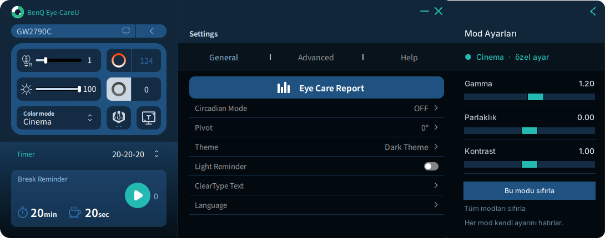

# Cinema Gamma

**Per-mode gamma, brightness and contrast for BenQ monitors, in a panel that docks to Eye-CareU.**

[Türkçe](README.tr.md) · [Download](../../releases/latest)



The BenQ GW2790C has no gamma or contrast control in its picture modes, and its Cinema mode is quite dark. GPU colour settings (NVIDIA, AMD, Intel) can fix that, but they apply to every mode. Cinema Gamma gives each Eye-CareU colour mode its own curve and switches it as soon as you change modes.

> **Unofficial.** This is a community project. It is not made, endorsed or supported by BenQ.

## Install

1. Download **`CinemaGamma-Setup-x.y.z.exe`** from the [latest release](../../releases/latest).
2. Run it and click **Next** until it finishes. It needs no administrator rights and no Python.

That's it. Cinema Gamma starts right away, and from then on whenever Windows starts. The panel appears next to Eye-CareU whenever Eye-CareU is open.

The installer is not code-signed, so Windows SmartScreen may say the publisher is unknown. Click **More info → Run anyway**.

**To remove it:** Settings → Apps → Cinema Gamma → Uninstall. The screen's original colours come back. Your settings stay in `%LOCALAPPDATA%\CinemaGamma`; delete that folder to remove them too.

## Usage

1. Open Eye-CareU and choose a colour mode, for example **Cinema**.
2. Move the sliders in the **Mod Ayarları** panel. The setting is saved for that mode only.
3. Switch modes. Each mode loads its own setting. A mode you never adjusted shows **varsayılan** (default).

The arrow at the top right folds the panel into a small tab on Eye-CareU's edge; the tab's arrow opens it again. The panel remembers whether it was open.

The panel's labels are in Turkish:

| Panel label | Meaning |
|---|---|
| Gamma / Parlaklık / Kontrast | Gamma / brightness / contrast |
| özel ayar | This mode has a custom setting |
| varsayılan | This mode uses the default |
| Bu modu sıfırla | Reset this mode |
| Tüm modları sıfırla | Reset all modes |
| ‹ / › | Fold the panel / open it again |

## Features

- **Docks to Eye-CareU.** The panel sits flush against the Eye-CareU window, in its colours and with matching rounded corners. When Eye-CareU is near the right edge of the screen, the panel moves to its left side.
- **Follows without polling.** Window events drive the panel. After Eye-CareU moves, the panel tracks it closely for 10 seconds, then goes idle, so it uses no CPU while nothing moves.
- **One setting per mode.** Gamma (0.70–1.60), brightness (−0.30 to +0.30) and contrast (0.50–1.50) are stored separately for Standard, Cinema, Game, ePaper, Care Mode and any other mode. Modes you never touch stay at the default.
- **Instant switching.** Mode changes show up in Eye-CareU's log, and the panel picks them up in about 0.2 seconds. A direct DDC/CI read of the monitor also catches changes made with the monitor's own buttons.
- **Safe.** It only reads from the monitor and never changes monitor settings. The curve is applied to the BenQ's output only. The original curve comes back when you switch to a mode with no custom setting, and when the program exits.

## Requirements and compatibility

- Windows 10 or 11, 64-bit
- BenQ Eye-CareU, with DDC/CI turned on in the monitor's menu (Eye-CareU needs it too)

| Tested | Expected to work, not yet tested |
|---|---|
| BenQ GW2790C with Eye-CareU 1.5.5.0 | Other BenQ monitors that Eye-CareU supports, such as the GW2490 and GW2790 families |

Mode names are read from Eye-CareU's own log, so other models' modes appear under their real names. If you try another model, please open an issue and say whether it worked.

## Known limitations

- Windows rejects very extreme curves. When that happens the panel shows *"Windows bu ayarı reddetti"*; move the slider back a little.
- In **Duplicate** display mode, the laptop screen shares the output and gets the same curve. In **Extend** mode, only the BenQ is affected.
- Other software that sets the gamma ramp, such as f.lux or a colour-calibration loader, can override the curve.

## How it works

Eye-CareU is closed source and has no plugin API, so Cinema Gamma runs alongside it:

- **Current mode.** Eye-CareU switches modes by writing VCP code `0xDC` (display mode) over DDC/CI, and it logs every switch (`setColorMode: "Cinema"`). Cinema Gamma watches that log for instant updates. It also reads `0xDC` from the monitor through `dxva2.dll` every 10 seconds while Eye-CareU is open, and every 20 seconds while it is closed.
- **Curve.** Each mode's setting becomes a gamma ramp. `SetDeviceGammaRamp` applies it only to the display output whose monitor ID starts with `BNQ`, BenQ's EDID vendor code.
- **Window.** A `SetWinEventHook` runs on its own thread and listens only to Eye-CareU's process. The panel is a borderless Tk window. It is moved with `SetWindowPos`, rounded with `SetWindowRgn`, and is per-monitor DPI aware.

Settings are saved in `%LOCALAPPDATA%\CinemaGamma\config.json`, and the log in `cinema_gamma.log` in the same folder.

## Development

The whole program is one file, [`cinema_gamma.py`](cinema_gamma.py), using only the Python standard library (ctypes and tkinter). To run it from source you need Python 3.9 or newer:

| Command | What it does |
|---|---|
| `python cinema_gamma.py` | Run with the log shown in the console |
| `python cinema_gamma.py --no-panel` | Apply the saved settings without showing the panel |
| `python cinema_gamma.py --install` / `--uninstall` | Add or remove a Startup shortcut for the source version |

The tests need neither Windows nor a monitor, because Win32 calls are stubbed:

```bash
python tests/test_logic.py              # engine, settings, Eye-CareU log watcher, docking geometry
python tests/test_panel.py              # Tk panel (needs a display; on Linux: xvfb-run python3 tests/test_panel.py)
```

GitHub Actions ([`build.yml`](.github/workflows/build.yml)) builds the installer on every push: it runs the tests, builds `CinemaGamma.exe` with PyInstaller and the setup wizard with Inno Setup ([`installer/CinemaGamma.iss`](installer/CinemaGamma.iss)), then starts the exe and silently installs and uninstalls it as a smoke test. Publishing a release with a tag such as `v1.2.3` attaches `CinemaGamma-Setup-1.2.3.exe` to it.

## License

[MIT](LICENSE). BenQ, Eye-CareU and the monitor model names belong to BenQ Corporation. They are used here only to describe compatibility.
