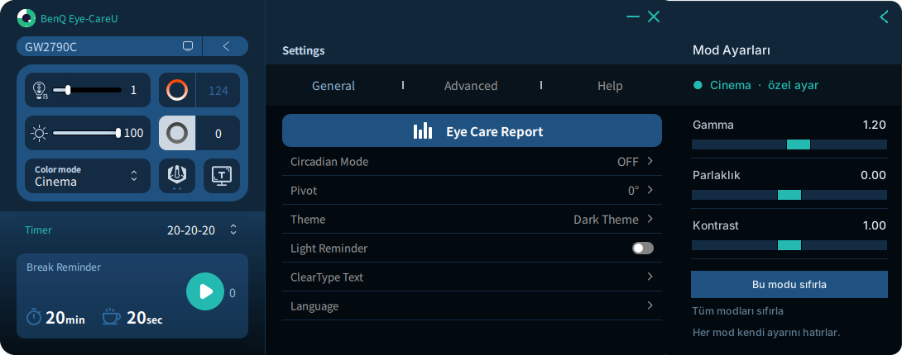

# Cinema Gamma

**BenQ monitörlerde her renk moduna ayrı gamma, parlaklık ve kontrast: Eye-CareU'nun yanına yapışan bir panel.**

[English](README.md) · [İndir](../../releases/latest)



BenQ GW2790C'nin resim modlarında gamma veya kontrast ayarı yok ve Cinema modu oldukça karanlık. Ekran kartı renk ayarları (NVIDIA, AMD, Intel) bunu düzeltebilir ama her moda birden uygulanır. Cinema Gamma, Eye-CareU'daki her renk moduna kendi eğrisini verir ve modu değiştirdiğiniz anda o modun ayarına geçer.

> **Resmî değildir.** Bu bir topluluk projesidir; BenQ tarafından yapılmamış, onaylanmamış ve desteklenmemektedir.

## Kurulum

1. [Son sürümden](../../releases/latest) **`CinemaGamma-Setup-x.y.z.exe`** dosyasını indirin.
2. Çalıştırıp bitene kadar **İleri**'ye basın. Yönetici izni ve Python gerekmez.

Hepsi bu. Cinema Gamma hemen ve bundan sonra her Windows açılışında kendiliğinden başlar; Eye-CareU açıldığında panel yanında görünür.

Kurulum dosyası kod imzalı olmadığı için Windows SmartScreen "bilinmeyen yayımcı" uyarısı verebilir. **Ek bilgi → Yine de çalıştır**'a basın.

**Kaldırmak için:** Ayarlar → Uygulamalar → Cinema Gamma → Kaldır. Ekranın orijinal renkleri geri gelir. Ayarlarınız `%LOCALAPPDATA%\CinemaGamma` klasöründe kalır; onları da silmek için bu klasörü silin.

## Kullanım

1. Eye-CareU'yu açıp bir renk modu seçin, örneğin **Cinema**.
2. **Mod Ayarları** panelindeki kaydırıcıları oynatın. Ayar yalnızca o mod için kaydedilir.
3. Mod değiştirin. Her mod kendi ayarını yükler; hiç ayarlamadığınız modlarda **varsayılan** yazar.

Sağ üstteki ok, paneli Eye-CareU'nun kenarında küçük bir kareye katlar; karenin üzerindeki ok paneli yeniden açar. Panel açık mı kapalı mı olduğunu hatırlar.

| Düğme | Ne yapar |
|---|---|
| Bu modu sıfırla | Geçerli modu varsayılana döndürür |
| Tüm modları sıfırla | Bütün modları varsayılana döndürür |
| ‹ / › | Paneli katlar / yeniden açar |

## Özellikler

- **Eye-CareU'ya yapışır.** Panel, Eye-CareU penceresine boşluksuz yapışır; aynı renkleri ve aynı yuvarlak köşeleri kullanır. Eye-CareU ekranın sağ kenarına yakınsa panel sol tarafa geçer.
- **Sürekli kontrol etmeden takip eder.** Paneli pencere olayları yönetir. Eye-CareU hareket ettikten sonra 10 saniye boyunca sıkı takip eder, sonra uykuya geçer; hiçbir şey hareket etmezken işlemci kullanmaz.
- **Her moda ayrı ayar.** Gamma (0,70–1,60), parlaklık (−0,30 ile +0,30 arası) ve kontrast (0,50–1,50); Standard, Cinema, Game, ePaper, Care Mode ve diğer tüm modlar için ayrı saklanır. Hiç dokunmadığınız modlar varsayılanda kalır.
- **Anında geçiş.** Mod değişikliği Eye-CareU'nun günlüğüne düşer ve panel bunu yaklaşık 0,2 saniyede yakalar. Monitörün kendi tuşlarıyla yapılan değişiklikleri de monitörden DDC/CI ile doğrudan okuyarak yakalar.
- **Güvenli.** Monitörden yalnızca okur, monitör ayarlarını asla değiştirmez. Eğri yalnızca BenQ'nun bağlı olduğu çıkışa uygulanır. Özel ayarı olmayan bir moda geçtiğinizde ve program kapandığında orijinal eğri geri gelir.

## Gereksinimler ve uyumluluk

- Windows 10 veya 11, 64 bit
- BenQ Eye-CareU; monitörün menüsünde DDC/CI açık olmalı (Eye-CareU'nun da buna ihtiyacı var)

| Test edildi | Çalışması beklenir, henüz test edilmedi |
|---|---|
| BenQ GW2790C, Eye-CareU 1.5.5.0 | Eye-CareU'nun desteklediği diğer BenQ monitörler, örneğin GW2490 ve GW2790 aileleri |

Mod adları Eye-CareU'nun kendi günlüğünden okunduğu için diğer modellerin modları da gerçek adlarıyla görünür. Başka bir modelde denerseniz çalışıp çalışmadığını bir issue açarak bildirin.

## Bilinen sınırlamalar

- Windows çok uç eğrileri reddeder. Bu durumda panelde *"Windows bu ayarı reddetti"* yazar; kaydırıcıyı biraz geri çekin.
- **Çoğalt** (Duplicate) görüntü modunda dizüstü ekranı aynı çıkışı paylaştığı için aynı eğriyi alır. **Genişlet** (Extend) modunda yalnızca BenQ etkilenir.
- Gamma rampasını ayarlayan başka yazılımlar (f.lux veya bir renk kalibrasyonu yükleyicisi gibi) eğrinin üzerine yazabilir.

## Nasıl çalışır

Eye-CareU kapalı kaynaklıdır ve eklenti desteği yoktur; Cinema Gamma onun yanında ayrı bir program olarak çalışır:

- **Geçerli mod.** Eye-CareU modu, DDC/CI üzerinden `0xDC` (display mode) VCP koduna yazarak değiştirir ve her geçişi günlüğüne yazar (`setColorMode: "Cinema"`). Cinema Gamma anında haberdar olmak için bu günlüğü izler. Ayrıca `0xDC` değerini `dxva2.dll` ile monitörden doğrudan okur: Eye-CareU açıkken 10 saniyede bir, kapalıyken 20 saniyede bir.
- **Eğri.** Her modun ayarından bir gamma rampası üretilir. `SetDeviceGammaRamp` bunu yalnızca monitör kimliği BenQ'nun EDID üretici kodu `BNQ` ile başlayan çıkışa uygular.
- **Pencere.** `SetWinEventHook` kendi iş parçacığında çalışır ve yalnızca Eye-CareU'nun sürecini dinler. Panel kenarlıksız bir Tk penceresidir: `SetWindowPos` ile taşınır, `SetWindowRgn` ile köşeleri yuvarlanır ve her monitörün DPI ölçeğine uyar.

Ayarlar `%LOCALAPPDATA%\CinemaGamma\config.json` dosyasında, günlük aynı klasördeki `cinema_gamma.log` dosyasında tutulur.

## Geliştirme

Programın tamamı tek bir dosya, [`cinema_gamma.py`](cinema_gamma.py); yalnızca Python'un standart kütüphanesini (ctypes ve tkinter) kullanır. Kaynaktan çalıştırmak için Python 3.9 veya daha yenisi gerekir:

| Komut | Ne yapar |
|---|---|
| `python cinema_gamma.py` | Günlüğü konsolda göstererek çalıştırır |
| `python cinema_gamma.py --no-panel` | Paneli göstermeden yalnızca kayıtlı ayarları uygular |
| `python cinema_gamma.py --install` / `--uninstall` | Kaynak sürümü için Başlangıç kısayolunu ekler / kaldırır |

Win32 çağrıları taklit edildiği için testler Windows'a veya monitöre ihtiyaç duymaz:

```bash
python tests/test_logic.py              # motor, ayarlar, Eye-CareU günlük izleyicisi, yapışma geometrisi
python tests/test_panel.py              # Tk paneli (ekran gerekir; Linux'ta: xvfb-run python3 tests/test_panel.py)
```

Kurulum dosyasını her push'ta GitHub Actions ([`build.yml`](.github/workflows/build.yml)) üretir: testleri çalıştırır, `CinemaGamma.exe`'yi PyInstaller ile, kurulum sihirbazını Inno Setup ile ([`installer/CinemaGamma.iss`](installer/CinemaGamma.iss)) derler, sonra exe'yi çalıştırıp sessizce kurup kaldırarak dener. `v1.2.3` gibi bir etiketle sürüm yayımlandığında `CinemaGamma-Setup-1.2.3.exe` o sürüme eklenir.

## Lisans

[MIT](LICENSE). BenQ, Eye-CareU ve monitör model adları BenQ Corporation'a aittir; burada yalnızca uyumluluğu belirtmek için kullanılmıştır.
